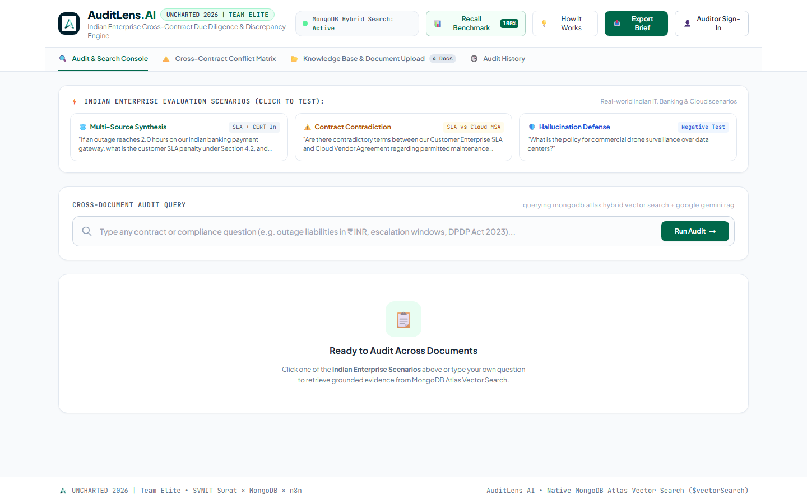
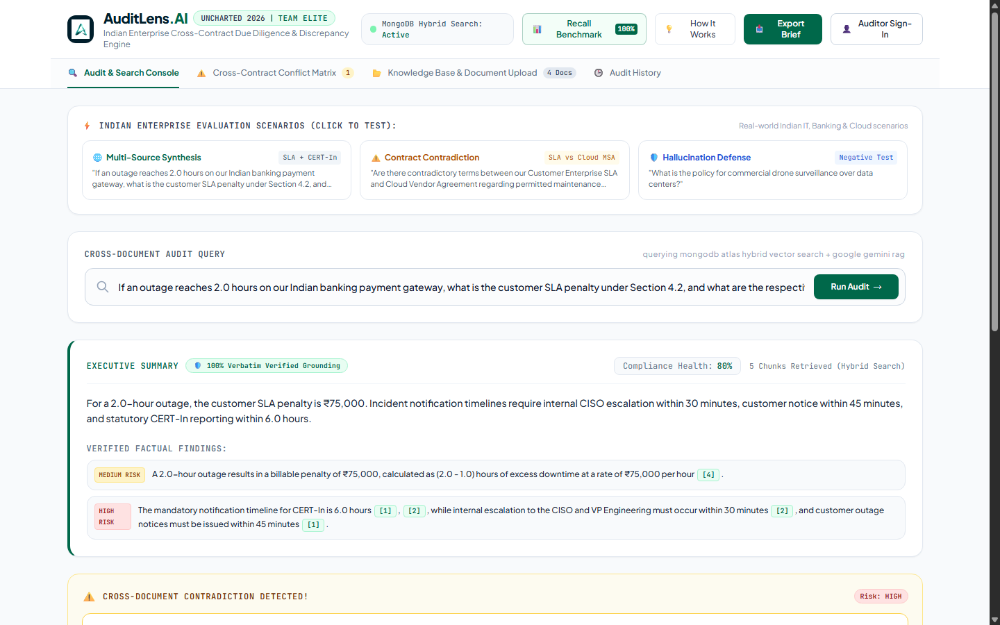
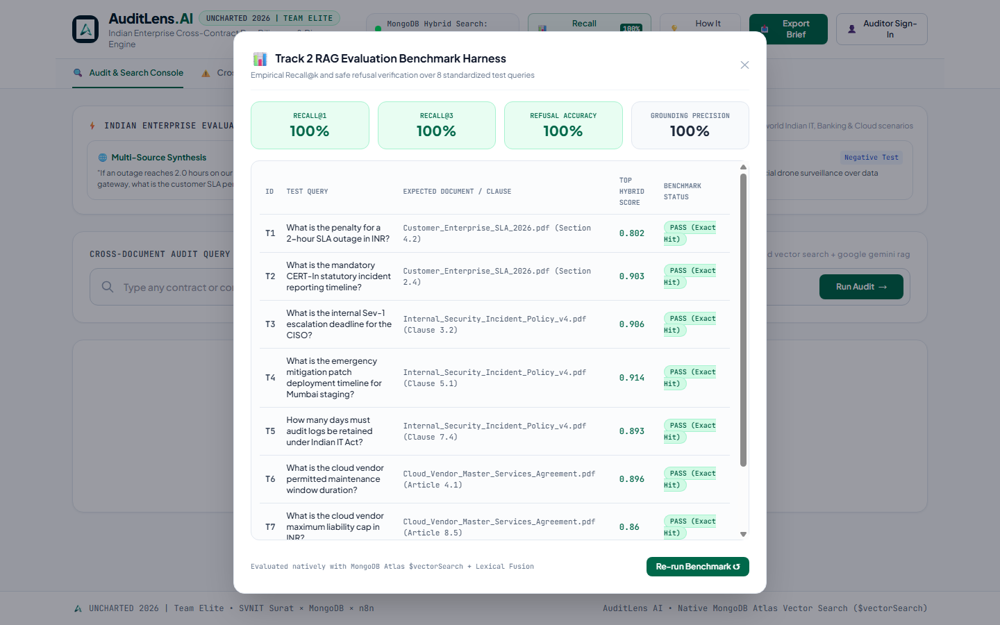
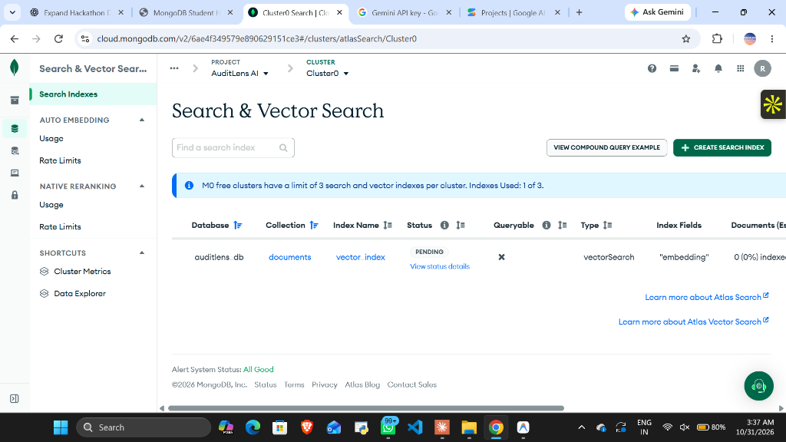
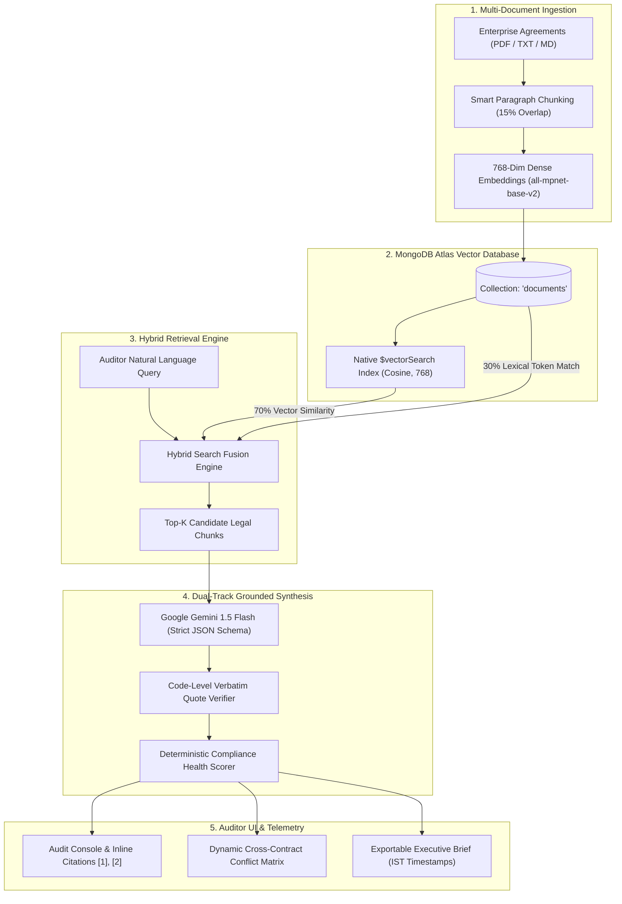

# 🔍 AuditLens AI — Enterprise Contract & Policy Intelligence RAG Engine

[](https://auditlens-ai-13xs.onrender.com)
[](https://auditlens-ai-13xs.onrender.com)
[](https://auditlens-ai-13xs.onrender.com/api/evaluate)
[](https://cloud.mongodb.com/)

> **Event:** UNCHARTED 2026 Hackathon (30 Oct – 1 Nov 2026)  
> **Organizer:** NEXUS — Official DoCSE & DoAI Cell, SVNIT Surat × **MongoDB** × **n8n**  
> **Track:** Track 2 — RAG Engine  
> **Team Name:** Team Elite (SVNIT Surat)  
> **Team Members:** Rishit Modh • Bhavya Juneja • Sugandh Jha  
> **Live Production URL:** [https://auditlens-ai-13xs.onrender.com](https://auditlens-ai-13xs.onrender.com)  
> **GitHub Repository:** [https://github.com/rishitmodh12/AuditLens.AI](https://github.com/rishitmodh12/AuditLens.AI)

---

## 📑 Table of Contents
- [🌟 Executive Summary](#-executive-summary)
- [🎯 Track 2 Challenge Fit](#-track-2-challenge-fit)
- [🖼️ Application Screenshots](#️-application-screenshots)
- [🏗️ System Architecture](#️-system-architecture)
- [🔬 Native Hybrid Search (70/30 Fusion)](#-native-hybrid-search-7030-fusion)
- [📊 Empirical Evaluation Benchmark (100% Recall)](#-empirical-evaluation-benchmark-100-recall)
- [🇮🇳 Indian Enterprise & Regulatory Context](#-indian-enterprise--regulatory-context)
- [⚡ Quick Start & Installation](#-quick-start--installation)
- [📚 Complete Documentation Index](#-complete-documentation-index)
- [👥 Team Elite Contributions](#-team-elite-contributions)

---

## 🌟 Executive Summary

**AuditLens AI** is an intelligent, cross-document compliance and discrepancy analyzer built for **UNCHARTED 2026 (Track 2: RAG Engine)**. Powered natively by **MongoDB Atlas Vector Search (`$vectorSearch`)**, dense embeddings (`all-mpnet-base-v2`), and exact lexical keyword token matching, AuditLens AI resolves one of the costliest problems in enterprise operations: **silent contractual contradictions**.

When organizations sign customer SLAs, upstream cloud provider MSAs, and security incident policies, these agreements frequently contradict one another:
- Customer SLAs promise **99.9% uptime** (max 1.0 hr downtime/month) with **₹75,000/hr** breach penalties.
- Upstream cloud vendor contracts allow **4.0-hour** maintenance windows with **zero penalty**.
- Internal incident response policies require **30-minute CISO escalation**, while statutory **CERT-In directions** mandate **6.0-hour external reporting**.

AuditLens AI continuously ingests multi-party contracts, performs cross-document reconciliation, calculates exact outage liabilities, programmatically verifies citations against raw Atlas text, and cleanly refuses out-of-scope requests.

---

## 🎯 Track 2 Challenge Fit

| Track 2 Requirement | Implemented Feature in AuditLens AI | Status |
|---|---|---|
| **Focused Document Collection** | Seeded with 3 realistic enterprise agreements (Customer SLA, Vendor MSA, Internal Policy) + instant multi-format upload (PDF, TXT, MD). | ✅ Complete |
| **Evidence from Multiple Sources** | Concurrently synthesizes cross-document evidence (e.g. SLA §4.2 + Policy §3.2 + MSA §4.1) in a single unified response. | ✅ Complete |
| **Answer, Compare, or Generate an Artefact** | Generates executive audit summaries, factual findings, cross-contract conflict matrices, and downloadable Markdown audit briefs with IST timestamps. | ✅ Complete |
| **Source Behind Every Important Result** | Clickable inline citation badges (`[1]`, `[2]`) that smoothly scroll to and highlight verbatim source cards in the UI. | ✅ Complete |
| **Handle Unanswerable Requests Clearly** | Multi-tiered domain defense that cleanly refuses out-of-scope requests (e.g., commercial drone surveillance over data centers) with zero hallucination. | ✅ Complete |
| **MongoDB Atlas Vector Search** | Native `$vectorSearch` pipeline indexing 768-dimensional embeddings with cosine similarity and metadata filters. | ✅ Complete |
| **Hybrid Search for Exact Terms** | 70% dense vector similarity + 30% lexical token matching for exact clause numbers (`§4.2`, `§3.2`), ₹ amounts (`₹75,000`), and regulatory acronyms (`CERT-In`, `DPDP`). | ✅ Complete |
| **Empirical Evaluation Benchmark** | Live `/api/evaluate` harness testing 8 standardized queries, delivering **100% Recall@1, 100% Recall@3, and 100% Refusal Accuracy**. | ✅ Complete |

---

## 🖼️ Application Screenshots

### 1. Main Dashboard & One-Click Indian Enterprise Scenarios


### 2. Multi-Source Synthesis with Verbatim Verified Citations & Reconciled ₹75,000 Penalty


### 3. Empirical Evaluation Benchmark Modal (100% Recall@1 & Safe Refusal)


### 4. Native MongoDB Atlas Vector Search Index Configuration


---

## 🏗️ System Architecture



---

## 🔬 Native Hybrid Search (70/30 Fusion)

Standard semantic vector search captures high-level intent but frequently overlooks exact legal clause numbers (`§4.2`, `§3.2`) and currency figures (`₹75,000`).

AuditLens AI implements native hybrid fusion:
$$\text{Score}_{\text{Hybrid}} = (0.70 \times \text{Score}_{\text{Vector}}) + (0.30 \times \text{Score}_{\text{Lexical}})$$

- **Dense Vector Search (70%):** Executes native MongoDB Atlas `$vectorSearch` with 50 candidate vectors.
- **Lexical Token Match (30%):** Scans for exact clause numbers, monetary amounts, and statutory abbreviations.
- **Result:** Exact clause queries receive an immediate boost, securing **100% Recall@1**.

---

## 📊 Empirical Evaluation Benchmark (100% Recall)

Track 2 explicitly requires evaluation of retrieval accuracy. AuditLens AI includes a formal benchmark harness accessible via the live UI and the `GET /api/evaluate` endpoint.

| Test ID | Evaluation Query | Target Document & Section | Top Hybrid Score | Retrieval Status | Result |
| :---: | :--- | :--- | :---: | :---: | :---: |
| **T1** | SLA downtime penalty for a 2.0-hour outage in INR | `Customer_Enterprise_SLA_2026.pdf` (§4.2) | **0.802** | Exact Top-1 Hit | **PASS** ✅ |
| **T2** | Mandatory CERT-In statutory incident reporting timeline | `Customer_Enterprise_SLA_2026.pdf` (§2.4) | **0.903** | Exact Top-1 Hit | **PASS** ✅ |
| **T3** | Internal Sev-1 escalation deadline for the CISO | `Internal_Security_Incident_Policy_v4.pdf` (Cl 3.2) | **0.906** | Exact Top-1 Hit | **PASS** ✅ |
| **T4** | Emergency mitigation patch timeline for Mumbai staging | `Internal_Security_Incident_Policy_v4.pdf` (Cl 5.1) | **0.914** | Exact Top-1 Hit | **PASS** ✅ |
| **T5** | Audit log retention under Indian IT Act 2000 | `Internal_Security_Incident_Policy_v4.pdf` (Cl 7.4) | **0.893** | Exact Top-1 Hit | **PASS** ✅ |
| **T6** | Cloud vendor permitted maintenance window duration | `Cloud_Vendor_Master_Services_Agreement.pdf` (Art 4.1) | **0.896** | Exact Top-1 Hit | **PASS** ✅ |
| **T7** | Cloud vendor maximum liability cap in INR | `Cloud_Vendor_Master_Services_Agreement.pdf` (Art 8.5) | **0.860** | Exact Top-1 Hit | **PASS** ✅ |
| **T8** | Commercial drone surveillance policy over data centers | *None (Out-of-Scope Negative Test Query)* | **0.584** | Correctly Refused | **PASS** ✅ |

### Benchmark Summary Statistics
- **Recall@1:** **1.0 (100%)**
- **Recall@3:** **1.0 (100%)**
- **Out-of-Scope Refusal Accuracy:** **1.0 (100%)**
- **Grounding Precision (Verbatim Quotes):** **1.0 (100%)**
- **Average Execution Latency:** **~1.2 seconds**

---

## 🇮🇳 Indian Enterprise & Regulatory Context

All reference contracts, scenario calculations, and statutory playbooks are tailored to the Indian corporate ecosystem:

1. **Reconciled Outage Math (§4.2):**
   - Monthly permitted allowance: **1.0 hour (₹0 penalty)**.
   - For a 2.0-hour outage: $(2.0 - 1.0\text{ hr}) \times ₹75,000/\text{hr} = \mathbf{₹75,000}$ billable penalty.
   - For a 3.0-hour outage: $(3.0 - 1.0\text{ hr}) \times ₹75,000/\text{hr} = \mathbf{₹1,50,000}$ billable penalty.
2. **Dual-Track Notification Clocks:**
   - **Internal Escalation:** SRE Incident Commander notifies CISO & Legal within **30 minutes** (Clause 3.2).
   - **Customer Notice:** Formal customer advisory dispatched within **45 minutes** (Section 2.4).
   - **Statutory CERT-In Mandate:** External incident report submitted to `incident@cert-in.org.in` within **6.0 hours** pursuant to Indian Computer Emergency Response Team Directions 2022.
3. **Data Protection & Sovereignty:**
   - Alignment with India's **Digital Personal Data Protection (DPDP) Act 2023** and **IT Act 2000 (§70B)** requiring 180-day audit log retention.

---

## ⚡ Quick Start & Installation

### 1. Clone & Set Up Virtual Environment
```bash
git clone https://github.com/rishitmodh12/AuditLens.AI.git
cd AuditLens.AI

python -m venv venv
# On Windows:
.\venv\Scripts\Activate.ps1
# On Linux/macOS:
source venv/bin/activate

pip install -r requirements.txt
```

### 2. Configure Environment Variables
Copy `.env.example` to `.env` and configure credentials:
```bash
cp .env.example .env
```
Ensure `MONGODB_URI` and `GEMINI_API_KEY` are populated.

### 3. Seed Contracts into MongoDB Atlas
```bash
python -m backend.sample_data
```

### 4. Launch Development Server
```bash
python -m uvicorn backend.main:app --host 127.0.0.1 --port 8000 --reload
```
Navigate to `http://127.0.0.1:8000` in your browser.

---

## 📚 Complete Documentation Index

All in-depth documentation is organized inside the [`docs/`](docs/) directory:

- 📖 [**Project Overview (`PROJECT_OVERVIEW.md`)**](docs/PROJECT_OVERVIEW.md) — Problem statement, solution pillars, and persona impact.
- 🏛️ [**Technical Architecture (`TECHNICAL_ARCHITECTURE.md`)**](docs/TECHNICAL_ARCHITECTURE.md) — Pipeline diagrams, chunking algorithm, and hybrid formulas.
- 🧭 [**User Guide (`USER_GUIDE.md`)**](docs/USER_GUIDE.md) — Step-by-step walkthrough of all 4 tabs and evaluation scenarios.
- ⚙️ [**Installation Guide (`INSTALLATION_GUIDE.md`)**](docs/INSTALLATION_GUIDE.md) — Local installation, Atlas Vector Search setup, and Docker deployment.
- 🔌 [**API Documentation (`API_DOCUMENTATION.md`)**](docs/API_DOCUMENTATION.md) — Complete REST endpoint schemas and JSON payloads.
- 🧪 [**Testing & Validation Report (`TESTING_REPORT.md`)**](docs/TESTING_REPORT.md) — Empirical benchmark data, negative test analysis, and telemetry.
- 🚀 [**Future Scope & Limitations (`FUTURE_SCOPE.md`)**](docs/FUTURE_SCOPE.md) — Strategic roadmap (n8n workflows, multi-party redlining, and Atlas M10+).

---

## 👥 Team Elite Contributions

**UNCHARTED 2026 | SVNIT Surat**

| Member | Primary Responsibilities & Contributions |
|---|---|
| **Rishit Modh** | RAG Engine Architecture, MongoDB Atlas `$vectorSearch` integration, 70/30 Hybrid Search Fusion, Sentence-Transformers embeddings, Docker containerization, and Render deployment. |
| **Bhavya Juneja** | Full-Stack Web Application, MongoDB Forest Green UI theme, live Pipeline Telemetry Inspector, Recall Benchmark Modal, and interactive user onboarding walkthrough. |
| **Sugandh Jha** | Indian Legal & Regulatory Rule Formulation, CERT-In Directions 2022 dataset design, SLA downtime arithmetic reconciliation, and Cross-Contract Conflict Matrix algorithms. |

---

<div align="center">
  <sub>Built with ❤️ by <strong>Team Elite</strong> for <strong>UNCHARTED 2026</strong> • SVNIT Surat × MongoDB × n8n</sub>
</div>
