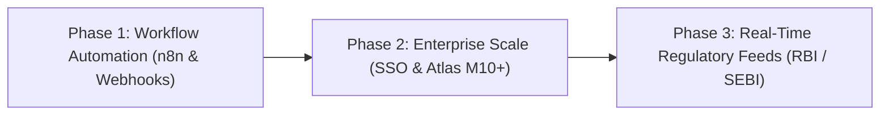

# Future Scope & Limitations: AuditLens AI
**UNCHARTED 2026 | Track 2: RAG Engine**  
**Team Elite (SVNIT Surat): Rishit Modh, Bhavya Juneja, Sugandh Jha**

---

## 1. Strategic Roadmap

AuditLens AI is designed to scale from a hackathon prototype into an enterprise-grade LegalTech & Compliance SaaS platform. Our forward-looking development roadmap is structured across three phases:

---

## 2. Phase 1: Near-Term Enhancements (Q4 2026)

### 2.1 n8n Webhook Workflow Automation
While AuditLens AI currently detects contractual contradictions and calculates SLA liabilities, enterprise incident response requires automated execution. 
- **Incident Escalation:** When a High-Severity contradiction is flagged, an outgoing webhook automatically triggers an **n8n workflow**.
- **Jira / ServiceNow Integration:** n8n creates a priority compliance incident ticket assigned to Legal and FinOps.
- **Real-Time Alerting:** Alerts are dispatched to dedicated Slack or Microsoft Teams incident channels with the exact section citation and liability cap.

### 2.2 Generative Multi-Party Clause Redlining
- Beyond identifying discrepancies, AuditLens AI will generate proposed contract amendments.
- For example, if a Cloud Vendor MSA allows 4.0 hours of maintenance while a Customer SLA allows 1.0 hour, the system will output a harmonized clause:
  > *"Proposed Amendment to Article 4.1: Scheduled infrastructure maintenance shall be restricted to non-peak weekend hours (02:00–04:00 IST) and shall not exceed 1.0 cumulative hour in any calendar month without prior written consent."*

### 2.3 Formatted PDF & DOCX Report Downloads
- Extend the current Markdown export feature to generate branded, executive PDF reports (via headless browser printing) and editable DOCX redline files for legal counsel.

---

## 3. Phase 2: Enterprise Scaling & Security (Q1 2027)

### 3.1 Scaling to MongoDB Atlas M10+ Dedicated Clusters
- Transition from the free Atlas M0 tier to dedicated M10/M20 multi-region clusters.
- Implement **multi-tenant sharding** to support organizations storing tens of thousands of active vendor agreements.
- Leverage **MongoDB Atlas Change Streams** to re-index documents in real time whenever legal contracts are updated in Google Drive or SharePoint.

### 3.2 Enterprise SSO & Role-Based Access Control (RBAC)
- Integrate SAML 2.0 / Okta / Azure AD authentication.
- Establish document-level security partitions so confidential M&A agreements or executive compensation terms are only accessible to authorized corporate counsel.

### 3.3 Upstream CLM Integrations
- Connect via REST webhooks to enterprise Contract Lifecycle Management (CLM) systems such as **Ironclad, DocuSign CLM, and SAP Ariba** to audit contracts automatically before signing.

---

## 4. Phase 3: Regulatory Intelligence & Specialized LLMs (Q2 2027)

### 4.1 Real-Time Regulatory Feed Sync
- Ingest live statutory updates from Indian regulatory bodies:
  - **Reserve Bank of India (RBI):** Master Directions on Outsourcing of IT Services.
  - **Securities and Exchange Board of India (SEBI):** Cyber Security & Cyber Resilience Framework.
  - **CERT-In:** Live vulnerability advisories and breach notification updates.
  - **Data Protection Board of India:** Rules under the Digital Personal Data Protection Act 2023.

### 4.2 Fine-Tuned Indian Legal Embeddings
- Train domain-specific embedding adapters on the Indian legal and commercial regulatory corpus to further improve retrieval precision on regional statutory terminology.

---

## 5. System Limitations & Known Constraints

Transparency is an essential criterion in hackathon evaluation. The current prototype has the following documented constraints:

1. **Scanned PDF Optical Character Recognition (OCR):**
   - The current ingestion pipeline uses `pypdf`, which expects digitized text layers. Scanned bitmap PDFs without embedded text layers require pre-processing with Tesseract OCR.
2. **MongoDB Atlas M0 Free Tier Limits:**
   - The prototype operates on a shared M0 cluster (512 MB storage limit and max 3 search indexes). Large enterprise corpora (> 10,000 contracts) require upgrading to dedicated Atlas tiers.
3. **Render Cold-Start Latency:**
   - On the Render free/starter tier, instances spin down after 15 minutes of inactivity. Initial cold-start requests take ~30–45 seconds before normal 1.2-second performance resumes.
4. **Token Context Limits:**
   - Gemini 1.5 Flash supports up to 1M tokens, but our retrieval pipeline caps top-k chunks at 5–8 documents to minimize latency and enforce strict precision.
