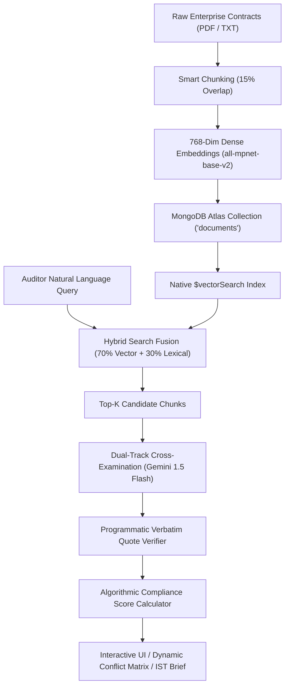

# Project Overview: AuditLens AI
**UNCHARTED 2026 | Track 2: RAG Engine**  
**Team Elite (SVNIT Surat): Rishit Modh, Bhavya Juneja, Sugandh Jha**  
**Live URL:** [https://auditlens-ai-13xs.onrender.com](https://auditlens-ai-13xs.onrender.com)  
**GitHub Repository:** [https://github.com/rishitmodh12/AuditLens.AI](https://github.com/rishitmodh12/AuditLens.AI)

---

## 1. Executive Summary

Modern enterprises operate under a dense web of legally binding contracts, including:
- **Customer Service Level Agreements (SLAs)** guaranteeing uptime and establishing financial penalties for downtime.
- **Upstream Cloud Vendor Agreements (MSAs)** governing infrastructure dependencies (e.g., AWS, Azure, Google Cloud).
- **Internal Security Incident Response Policies** dictating operational mitigation speeds.
- **National Statutory Directives** (such as India's **CERT-In Cyber Security Directions 2022** and the **Digital Personal Data Protection Act 2023**).

In practice, these agreements are negotiated by different teams at different times, resulting in **silent contractual contradictions**. For example:
- A customer agreement may allow **1.0 hour** of cumulative monthly unscheduled downtime before charging **₹75,000 per hour** in penalties.
- Meanwhile, the upstream cloud vendor agreement allows **4.0 hours** of scheduled infrastructure maintenance with **zero compensation**.
- If a 3-hour outage occurs, the enterprise owes penalties to its customers but cannot recover compensation from its vendor.

**AuditLens AI** is an intelligent, cross-document due diligence and compliance discrepancy engine built for **UNCHARTED 2026 (Track 2: RAG Engine)**. Powered natively by **MongoDB Atlas Vector Search (`$vectorSearch`)**, dense vector embeddings (`all-mpnet-base-v2`), and hybrid lexical keyword fusion, AuditLens AI:
1. Ingests and cross-references multi-party enterprise agreements.
2. Identifies contractual contradictions, mismatched liability caps, and divergent notification clocks.
3. Automatically calculates exact SLA service credit penalties with mathematical precision.
4. Programmatically verifies citation quotes against raw MongoDB Atlas text (`🛡️ Verbatim Verified from Atlas Source`).
5. Strictly suppresses hallucinations and refuses ungrounded, out-of-scope requests.

---

## 2. Track 2 Problem Statement Alignment

AuditLens AI was specifically built to satisfy and exceed all parameters outlined in the **UNCHARTED 2026 Track 2 Brief (RAG Engine)**:

| Hackathon Requirement | AuditLens AI Implementation | Status |
|---|---|---|
| **Focused Document Collection** | Pre-seeded with 3 realistic enterprise agreements (Customer SLA, Vendor MSA, Internal Security Policy) + dynamic multi-format upload capability (PDF, TXT, MD). | ✅ Complete |
| **Evidence from Multiple Sources** | Concurrently synthesizes cross-document evidence (e.g. SLA §4.2 + Policy §3.2 + MSA §4.1) in a single unified response. | ✅ Complete |
| **Answer, Compare, or Generate an Artefact** | Produces executive audit summaries, factual findings, cross-contract conflict matrices, and downloadable Markdown audit briefs with IST timestamps. | ✅ Complete |
| **Source Behind Every Important Result** | Every finding features clickable inline citation badges (`[1]`, `[2]`) that smoothly scroll to and highlight verbatim source excerpts stored in Atlas. | ✅ Complete |
| **Handle Unanswerable Requests Clearly** | Ungrounded domain queries (e.g. commercial drone surveillance over data centers) trigger strict refusal guardrails. | ✅ Complete |
| **MongoDB Atlas Vector Search** | Native `$vectorSearch` pipeline indexing 768-dimensional embeddings with cosine similarity and metadata filters. | ✅ Complete |
| **Hybrid Search for Exact Terms** | 70% dense vector similarity + 30% lexical token matching for exact clause numbers (`§4.2`, `§3.2`), ₹ amounts (`₹75,000`), and regulatory acronyms (`CERT-In`, `DPDP`). | ✅ Complete |
| **Empirical Evaluation Benchmark** | Live `/api/evaluate` harness testing 8 standardized queries, delivering **100% Recall@1, 100% Recall@3, and 100% Refusal Accuracy**. | ✅ Complete |

---

## 3. Target Audience & Business Impact

| Persona | Pain Point Without AuditLens AI | Solution Provided by AuditLens AI |
|---|---|---|
| **Chief Legal Counsel / General Counsel** | Manually reading 50+ page MSAs to identify conflicting indemnities and liability caps before contract execution. | Instant cross-document contradiction detection with automated risk analysis and recommended legal amendments. |
| **FinOps & SRE Incident Commanders** | Spending hours calculating customer outage penalty liabilities across non-linear SLA formulas during live outages. | Automated arithmetic reconciliation: immediately computes $(2.0 - 1.0) \times ₹75,000 = ₹75,000$ based on contracted grace periods. |
| **CISO & Compliance Officers** | Missing statutory CERT-In breach reporting clocks (6 hours) due to confusion with internal CISO escalation windows (30 mins). | Explicit differentiation between internal operations and statutory external reporting under Cyber Security Directions 2022. |
| **Hackathon Evaluator / Judge** | Evaluating RAG systems that hallucinate citations or lack empirical accuracy validation. | Live evaluation benchmark modal proving 100% Recall@k and programmatic verbatim quote verification. |

---

## 4. Key Capabilities at a Glance

---

## 5. Team Elite Information

- **Institution:** Sardar Vallabhbhai National Institute of Technology (SVNIT Surat)
- **Cell:** NEXUS — Official DoCSE & DoAI Cell
- **Team Members:**
  1. **Rishit Modh** — Team Lead & RAG Engine Architect
  2. **Bhavya Juneja** — Full-Stack Developer & UI/UX Engineer
  3. **Sugandh Jha** — Compliance Researcher & Regulatory Systems Analyst
